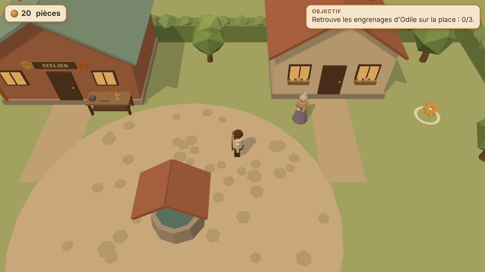

# L'Atelier de Cuivrebourg

Un petit jeu de gestion d'atelier en 3D, ambiance steampunk et artisanat,
qui se joue dans le navigateur, sur ordinateur comme sur téléphone Android.

Vous jouez **Ferrus Dantioch**, artisan-ingénieur. Il reprend un petit atelier
dans une ville en difficulté. Il fabrique et répare des objets pour les
habitants : chaque habitant a un problème à résoudre, ce sont les quêtes.

**Ceci est l'étape 1 (prototype)** : une place de village, Ferrus, Odile et
une première quête, « La lampe d'Odile ».



---

## Jouer sur téléphone (ou sans rien installer)

Ouvrez simplement cette adresse dans Chrome :

**https://ferrusdantioch.github.io/atelier-jeu/**

(Elle fonctionne une fois GitHub Pages activé pour ce dépôt, depuis la
branche `main` : voir « Publication » plus bas. GitHub met ensuite 1 à 2
minutes à publier chaque modification.)

Astuce : dans le menu de Chrome (les trois points), « Ajouter à l'écran
d'accueil » crée une icône pour lancer le jeu comme une application.

## Lancer le jeu sur son ordinateur

Il faut avoir installé [Node.js](https://nodejs.org/fr) (version 20 ou plus).
Ensuite, dans un terminal ouvert dans le dossier du jeu (la copie du dépôt `atelier-jeu`),
une seule commande :

```bash
npm start
```

Puis ouvrez **http://localhost:8080** dans votre navigateur.
Pour arrêter : `Ctrl + C` dans le terminal.

Pas besoin de `npm install` pour jouer : Three.js est déjà copié dans le
dossier `lib/three/`.

> Ouvrir `index.html` par double-clic ne marche pas : les navigateurs
> bloquent alors le jeu (le jeu l'explique d'ailleurs à l'écran). Il faut
> passer par `npm start`.

Le terminal affiche aussi une adresse du type `http://192.168.x.x:8080` :
un téléphone connecté **au même Wi-Fi** peut l'ouvrir pour jouer.

## Les commandes

| | Sur ordinateur | Sur téléphone |
|---|---|---|
| Se déplacer | `Z` `Q` `S` `D` ou les flèches (`W` `A` `S` `D` marche aussi) | Joystick en bas à gauche |
| Parler, utiliser | `E` ou `Espace` | Gros bouton **Interagir** en bas à droite |
| Dialogue : réplique suivante | `E` ou `Espace` | Toucher la boîte de dialogue |
| Dialogue : choisir une réponse | Flèches puis `E`, ou clic | Toucher la réponse |

## La quête « La lampe d'Odile »

1. Parlez à Odile, devant sa maison (à droite de la place), et acceptez.
2. Trois engrenages apparaissent sur la place : marchez dessus pour les ramasser.
3. Rapportez-les à l'établi, devant l'atelier, pour réparer la lampe à vapeur.
4. Rapportez la lampe à Odile : elle vous donne **120 pièces**.

Le cadre « Objectif », en haut, dit toujours quoi faire. Un petit losange
couleur ambre flotte au-dessus d'Odile ou de l'établi quand il y a quelque
chose à y faire.

## Confort visuel

Couleurs douces et chaudes, éclairage doux, aucun clignotement, aucune
secousse de caméra, aucun son. Si votre système demande « moins
d'animations », les engrenages et les marqueurs ne flottent plus.

## Vérifier les règles du jeu (tests automatiques)

```bash
npm test
```

(C'est la même chose que `node --test`.) 29 tests vérifient la quête,
l'argent et les collisions. Tout doit être indiqué `pass`.

## L'organisation des fichiers

| Fichier ou dossier | Rôle |
|---|---|
| `index.html` | La page du jeu : écran d'accueil, interface, message d'erreur |
| `css/style.css` | L'apparence : couleurs, tailles de texte, boutons tactiles |
| `js/logique.js` | **Les règles du jeu**, sans aucune 3D : plan de la place, collisions, quête, textes |
| `js/main.js` | Le chef d'orchestre : crée la scène 3D, la caméra, la lumière, et fait tourner le jeu |
| `js/decor.js` | La place en 3D : sol, haies, arbres, puits, atelier, maison d'Odile, établi, lampe |
| `js/personnages.js` | Ferrus (avec ses lunettes d'artisan) et Odile, et leurs animations |
| `js/commandes.js` | Le clavier, le joystick tactile et le bouton « Interagir » |
| `js/interface.js` | L'argent, l'objectif, les petits messages, la boîte de dialogue |
| `lib/three/` | Three.js 0.186.1 (le moteur 3D), copié ici pour ne dépendre d'aucun site extérieur |
| `tests/logique.test.js` | Les tests automatiques des règles |
| `serveur.js` | Le petit serveur lancé par `npm start` |
| `outils/copier-three.js` | Recopie Three.js de `node_modules` vers `lib/three/` (`npm run copier-three`) |
| `outils/creer-zip.js` | Fabrique l'archive de sauvegarde (`npm run zip`) |
| `atelier-cuivrebourg.zip` | Une sauvegarde de tout le projet (sans `node_modules`) |
| `captures/` | Des captures d'écran du jeu (ordinateur et téléphone) |
| `package.json` | La fiche du projet : nom, commandes, version de Three.js |

Le dossier `node_modules` (créé par `npm install`) n'est pas envoyé sur
GitHub : le fichier `.gitignore` l'en empêche.

## L'archive de sauvegarde

`atelier-cuivrebourg.zip` contient tout le projet, sauf `node_modules`. On
peut la télécharger depuis le téléphone à cette adresse :
https://ferrusdantioch.github.io/atelier-jeu/atelier-cuivrebourg.zip

Pour la refaire après une modification :

```bash
npm run zip
```

## Publication (GitHub Pages)

Le jeu est publié par GitHub Pages, depuis la branche `main`, dossier racine.
À faire une seule fois, sur le site de GitHub :

1. Ouvrir le dépôt `atelier-jeu`, puis **Settings** (Paramètres).
2. Dans le menu de gauche, **Pages**.
3. Dans « Build and deployment », choisir **Deploy from a branch**, puis la
   branche **main** et le dossier **/ (root)**, et cliquer **Save**.

Ensuite, chaque modification envoyée sur `main` est en ligne 1 à 2 minutes
plus tard.

## Mettre à jour Three.js (pour plus tard)

Changez la version dans `package.json`, puis lancez `npm install` : les
fichiers de `lib/three/` sont recopiés automatiquement. Vérifiez ensuite que
le jeu fonctionne toujours.

## La suite prévue

- **Étape 2** : la gestion de l'atelier (fabrication, stocks, clients, améliorations).
- **Étape 3** : plus de lieux, plus d'habitants, des quêtes enchaînées, la sauvegarde de la partie.
- **Étape 4** : la musique, les finitions pour téléphone, la publication.

## Droits

Code, textes et personnages © 2026 Ferrus Dantioch, tous droits réservés
(aucune licence n'a encore été choisie pour ce dépôt).
Three.js est un logiciel libre sous licence MIT (voir `lib/three/LICENSE`).
