# L'Atelier de Cuivrebourg

Un petit jeu de gestion d'atelier en 3D, ambiance steampunk et artisanat,
qui se joue dans le navigateur, sur ordinateur comme sur téléphone Android.

Vous jouez **Ferrus Dantioch**, artisan-ingénieur. Il reprend un petit atelier
dans une ville en difficulté. Il fabrique et répare des objets pour les
habitants : chaque habitant a un problème à résoudre, ce sont les quêtes.

**Où en est le jeu ?**

- **Étape 1** : une place de village, Ferrus, Odile et une première quête,
  « La lampe d'Odile ».
- **Étape 2** : la gestion de l'atelier. On achète des matériaux, on fabrique
  des objets, on sert des clients et on améliore l'atelier.
- **Étape 3** : deux nouveaux lieux (le marché et le moulin), trois nouveaux
  personnages, des quêtes qui s'enchaînent, et la sauvegarde automatique.
- **Étape 4 (version 1.0)** : une musique douce composée par le jeu (coupée
  au départ), de petits sons, un menu d'options, une démarche plus
  naturelle, un joystick qui vient sous le pouce, et le jeu s'installe sur
  un téléphone comme une application (il marche même sans connexion).
- **Version 1.0.1** : les clients ne se laissent plus traverser, et toutes
  les quêtes (la lampe d'Odile comprise) passent par le même moteur.
- **Version 1.1** : des personnages et un décor aux formes arrondies (fini
  l'aspect « carré »), et de l'eau qui bouge doucement.
- **Version 1.2** : une **gare à vapeur** avec Augustin le chef de gare et
  deux nouvelles quêtes, **le jour et la nuit** (les lanternes s'allument le
  soir), de la **fumée** qui sort des cheminées et du **vent** dans les arbres.

- **Version 1.3** : on **monte dans le train** jusqu'à la **mine de cuivre**
  (avec Sidonie la mineuse et une nouvelle quête), deux nouveaux objets pour
  les clients (la **boîte à musique** et l'**automate de cuivre**), et la nuit,
  des **lucioles** et des **étoiles qui se reflètent dans l'eau**.
- **Version 1.4** : on **descend dans la galerie** de la mine pour récolter
  soi-même du cuivre, **les saisons** se succèdent (fleurs, feuilles rousses,
  neige), un **carnet de commandes** spéciales apportées par Léon, et des
  **décorations** pour embellir l'atelier.

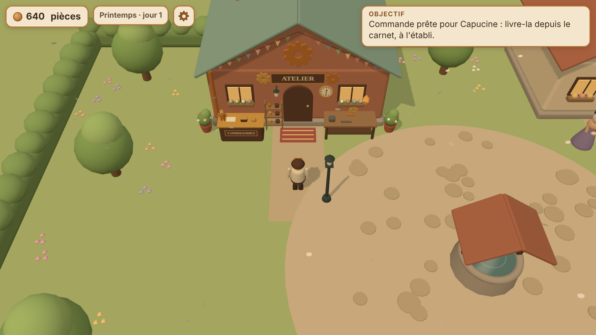

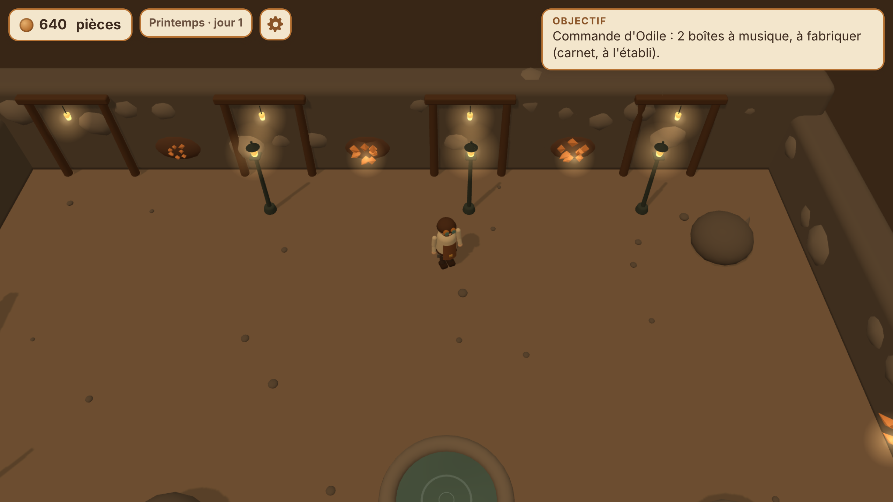

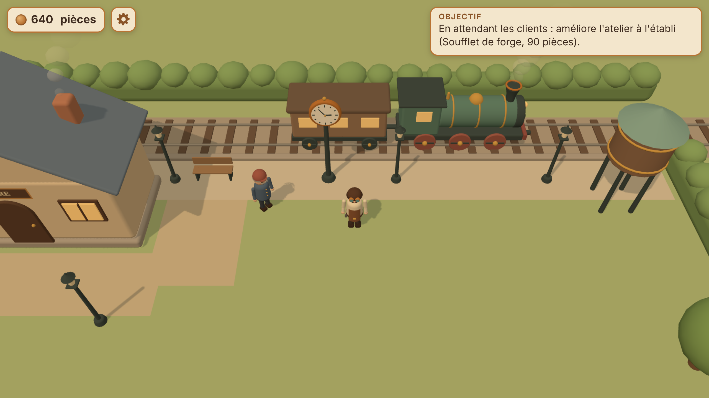

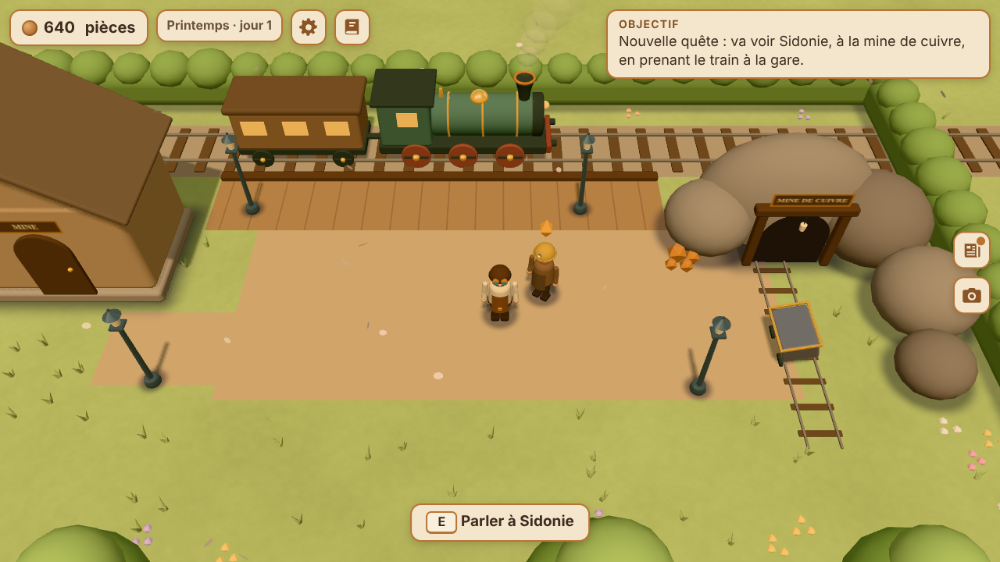


---

## Jouer sur téléphone (ou sans rien installer)

Ouvrez simplement cette adresse dans Chrome :

**https://ferrusdantioch.github.io/atelier-jeu/**

(Elle fonctionne une fois GitHub Pages activé pour ce dépôt, depuis la
branche `main` : voir « Publication » plus bas. GitHub met ensuite 1 à 2
minutes à publier chaque modification.)

### Installer le jeu sur le téléphone (comme une application)

Sur Android, avec Chrome :

1. Ouvrez l'adresse ci-dessus.
2. Touchez **Installer le jeu** (sur l'écran d'accueil du jeu, ou dans les
   options ⚙). Si le bouton n'apparaît pas : menu de Chrome (les trois
   points) → **Installer l'application** (ou « Ajouter à l'écran d'accueil »).
3. Une icône « Cuivrebourg » (un engrenage de cuivre) apparaît sur l'écran
   d'accueil du téléphone.

Lancé depuis cette icône, le jeu s'ouvre **en plein écran**, sans la barre
d'adresse, et il marche **même sans connexion** (dans le métro, en avion…).
Avec une connexion, il se met à jour tout seul. La partie sauvegardée est
la même que dans Chrome.

Sur iPhone (Safari) : bouton Partager → « Sur l'écran d'accueil ».

## Lancer le jeu sur son ordinateur

Il faut avoir installé [Node.js](https://nodejs.org/fr) (version 20 ou plus).
Ensuite, dans un terminal ouvert dans le dossier du jeu (la copie du dépôt `atelier-jeu`),
une seule commande :

```bash
npm start
```

Puis ouvrez **http://localhost:8080** dans votre navigateur.
Pour arrêter : `Ctrl + C` dans le terminal.

Pas besoin de `npm install` pour jouer : Three.js est déjà copié dans le
dossier `lib/three/`.

> Ouvrir `index.html` par double-clic ne marche pas : les navigateurs
> bloquent alors le jeu (le jeu l'explique d'ailleurs à l'écran). Il faut
> passer par `npm start`.

Le terminal affiche aussi une adresse du type `http://192.168.x.x:8080` :
un téléphone connecté **au même Wi-Fi** peut l'ouvrir pour jouer.

## Les commandes

| | Sur ordinateur | Sur téléphone |
|---|---|---|
| Se déplacer | `Z` `Q` `S` `D` ou les flèches (`W` `A` `S` `D` marche aussi) | Joystick en bas à gauche |
| Parler, utiliser | `E` ou `Espace` | Gros bouton **Interagir** en bas à droite |
| Dialogue : réplique suivante | `E` ou `Espace` | Toucher la boîte de dialogue |
| Dialogue : choisir une réponse | Flèches puis `E`, ou clic | Toucher la réponse |
| Panneau de l'établi | Souris (ou `Tab` puis `Entrée`) ; `Échap` ou `E` pour fermer | Toucher les boutons ; **Fermer** en haut |
| Options (musique, sons…) | `Échap`, ou le bouton ⚙ en haut | Bouton ⚙ en haut |

Sur téléphone, le pouce gauche peut se poser **n'importe où dans la moitié
gauche du bas de l'écran** : le joystick vient se placer dessous. Plus besoin
de viser le petit cercle. Au lâcher, il revient à sa place.


## La quête « La lampe d'Odile »

1. Parlez à Odile, devant sa maison (à droite de la place), et acceptez.
2. Trois engrenages apparaissent sur la place : marchez dessus pour les ramasser.
3. Rapportez-les à l'établi, devant l'atelier, pour réparer la lampe à vapeur.
4. Rapportez la lampe à Odile : elle vous donne **120 pièces**.

Le cadre « Objectif », en haut, dit toujours quoi faire. Un petit losange
couleur ambre flotte au-dessus d'Odile ou de l'établi quand il y a quelque
chose à y faire.

## La gestion de l'atelier (étape 2)

Quand Odile a payé, l'atelier ouvre ses portes. Ferrus explique alors en
trois phrases comment tout fonctionne.

- **Le comptoir** (à gauche de la porte de l'atelier) : les clients entrent
  par le portail du sud, font la queue (3 au maximum) et commandent un
  objet. Approchez-vous et appuyez sur `E` (ou **Interagir**) : si l'objet
  est prêt, donnez-le-lui pour être payé.
- **L'établi** (à droite de la porte) ouvre un panneau à cinq onglets :
  - **Fabriquer** : choisissez un objet. Il utilise des matériaux et prend
    quelques secondes. Une barre de progression s'affiche en haut de l'écran.
    Un seul objet à la fois.
  - **Acheter** : cuivre (8 pièces), bois (4) et ressorts (6).
  - **Améliorer** : des achats définitifs pour l'atelier.
  - **Décorer** (version 1.4) : des décorations pour la façade, juste pour
    le plaisir des yeux.
  - **Carnet** (version 1.4) : les commandes spéciales des habitants.
- **Le stock** : 5 de chaque matériau et de chaque objet au maximum (10 avec
  les étagères).

| Objet | Il faut | Durée | Prix de vente |
|---|---|---|---|
| Lanterne | 1 cuivre, 1 ressort | 6 s | 32 pièces |
| Bouilloire à vapeur | 2 cuivres, 1 bois | 9 s | 45 pièces |
| Horloge mécanique | 1 cuivre, 1 bois, 2 ressorts | 14 s | 75 pièces |
| Boîte à musique (version 1.3) | 1 cuivre, 2 bois, 1 ressort | 12 s | 70 pièces |
| Automate de cuivre (version 1.3) | 3 cuivres, 2 ressorts | 18 s | 120 pièces |

| Amélioration | Prix | Effet |
|---|---|---|
| Étagères | 60 | 10 de chaque au lieu de 5 |
| Soufflet de forge | 90 | Fabrication deux fois plus rapide |
| Enseigne en cuivre | 110 | Un client toutes les 15 s au lieu de 25 s |
| Plans d'horloger | 140 | Débloque les horloges |
| Plans de boîte à musique | 120 | Débloque les boîtes à musique |
| Plans d'automate | — | Ne s'achètent pas : c'est le cadeau de Sidonie, à la mine |

Chaque amélioration apparaît dans le décor : étagères près de la porte,
soufflet sur l'établi, grand engrenage au-dessus de l'enseigne, plans roulés.
Avec la version 1.3, une petite boîte à musique et un automate (qui tourne
doucement la tête) se posent sur le comptoir. Quand vous vendez une boîte à
musique, elle joue sa petite ritournelle (si les sons sont activés).

Le cadre « Objectif » dit toujours quoi faire (acheter, fabriquer, servir),
et un petit losange ambre flotte au-dessus de l'établi ou du comptoir.
Personne n'est pressé : les clients attendent aussi longtemps qu'il faut.
Et si jamais l'atelier se retrouve coincé (ni argent, ni objet à vendre),
Odile prête 30 pièces pour repartir.

## Les lieux et les quêtes (étape 3)

Cuivrebourg compte maintenant six lieux (la gare est arrivée avec la
version 1.2, la mine avec la version 1.3, sa galerie souterraine avec la
version 1.4). On passe de l'un à l'autre en marchant jusqu'à la sortie, avec
un fondu doux ; pour la mine, on prend le train.

```
[ La place ] ─ portail du sud ─ [ Le marché ] ─ chemin de l'est ─ [ Le moulin ] ─ route de l'est ─ [ La gare ]
                                                                                                      │
                                                                                                    train
                                                                                                      │
                                                                                            [ La mine de cuivre ]
                                                                                                      │
                                                                                              entrée de la mine
                                                                                                      │
                                                                                            [ La galerie souterraine ]
```

- **La place** : l'atelier, Odile, le puits. Le portail du sud s'ouvre quand
  l'atelier ouvre.
- **Le marché** : des étals, une fontaine, **Capucine** la marchande et
  **Léon** le facteur (il connaît toutes les nouvelles et donne des indices).
  Le chemin du moulin est d'abord bloqué par un arbre tombé.
- **Le moulin** : le canal, la grande roue à aubes et **Barnabé** le meunier.
  La route de la gare, à l'est, est fermée par une barrière rayée.
- **La gare** (version 1.2) : la voie ferrée, le quai, la grande horloge, une
  locomotive verte et son wagon, un château d'eau, et **Augustin** le chef de
  gare.
- **La mine de cuivre** (version 1.3) : au bout de la voie ferrée, dans les
  collines. Un quai en bois, la cabane des mineurs, l'entrée de la mine dans
  les rochers, un wagonnet sur ses petits rails, et **Sidonie** la mineuse.
- **La galerie souterraine** (version 1.4) : sous la colline, des parois de
  roche, des lanternes, une petite source, et les **filons de cuivre**.

Les quêtes s'enchaînent : chacune ouvre la suivante.

1. **La lampe d'Odile** : ouvre l'atelier et le portail du marché.
2. **La balance de Capucine** : fabriquer une balance de précision à
   l'établi (2 cuivres, 1 ressort), puis la livrer à Capucine. Récompense :
   120 pièces, et le chemin du moulin est dégagé.
3. **La roue du moulin** : retrouver 3 pales dans l'herbe près du moulin,
   fabriquer un axe en laiton à l'établi (1 cuivre, 2 bois), l'installer sur
   le mécanisme au bord du canal, puis revenir voir Barnabé. Récompense :
   150 pièces, la roue tourne de nouveau, et la barrière de la gare se lève.
4. **L'horloge de la gare** : retrouver les 3 rouages de l'horloge autour de
   la gare, fabriquer un régulateur d'horloge (1 cuivre, 2 ressorts),
   l'installer dans l'horloge du quai, puis revenir voir Augustin.
   Récompense : 170 pièces. L'horloge donne ensuite l'heure du jeu.
5. **Le premier train** : fabriquer un sifflet à vapeur (2 cuivres, 1 bois),
   l'installer sur la locomotive, puis prévenir Augustin (« En voiture ! »).
   Récompense : 200 pièces. Ensuite, le train part régulièrement vers l'est,
   puis revient de l'ouest en ralentissant doucement, et on peut monter dedans.
6. **Le wagonnet de la mine** (version 1.3) : à la mine, ramasser les 3 pépites
   de cuivre tombées du wagonnet, fabriquer une roue de wagonnet à l'établi
   (1 cuivre, 1 bois, 1 ressort), la poser sur le wagonnet, puis revenir voir
   Sidonie. Récompense : 180 pièces et, en cadeau, **les plans de l'automate**.

Les objets de quête n'apparaissent à l'établi que pendant leur quête, et les
clients ne les commandent jamais. L'atelier continue de vivre pendant que
Ferrus est au marché ou au moulin (les fabrications avancent, les clients
attendent). Quand une quête est en cours et qu'un client attend, une
deuxième ligne « Atelier : … » s'affiche sous l'objectif.

## La sauvegarde

La partie se sauvegarde **toute seule** : après chaque action importante,
toutes les 5 secondes, et quand on quitte la page. Au retour, l'écran
d'accueil propose **Continuer la partie** ou **Nouvelle partie** (il faut
toucher deux fois pour confirmer, pour ne pas tout effacer par erreur).

À savoir :

- la sauvegarde reste **dans le navigateur de l'appareil** : la partie du
  téléphone et celle de l'ordinateur sont séparées ;
- effacer les données du site dans le navigateur efface aussi la partie ;
- en navigation privée, le navigateur peut refuser de sauvegarder (le jeu
  marche quand même, sans sauvegarde).
- une partie commencée avec une version plus ancienne continue sans souci :
  avec la version 1.4, elle reprend au jour 1, au printemps, avec un carnet
  de commandes vide.

## Les options (étape 4)

Le bouton ⚙ en haut de l'écran (ou `Échap` sur ordinateur, ou « Options »
sur l'écran d'accueil) ouvre les options. **Le jeu est en pause** pendant
qu'elles sont ouvertes (l'atelier attend aussi). Les réglages sont gardés
sur l'appareil, à part de la partie : « Nouvelle partie » ne les efface pas.

| Option | Au départ | Ce qu'elle fait |
|---|---|---|
| Musique douce | **Coupée** | Une musique lente et calme, différente dans chaque lieu (fa majeur sur la place, sol majeur plus enjoué au marché, ré plus rêveur au moulin). Volume en 5 crans. |
| Petits sons | **Coupés** | De douces notes de clochette : objet ramassé, pièces gagnées, fabrication terminée, client qui arrive. Volume en 5 crans. |
| Jour et nuit | Activé | Le soir tombe, les lanternes s'allument, puis le jour revient (une journée dure 8 minutes). « Toujours le jour » : la lumière ne change plus. |
| Saisons | Activées | Printemps, été, automne, hiver : chaque saison dure 2 jours du jeu (environ 16 minutes). « Toujours l'été » : le décor ne change plus. |
| Qualité de l'image | Normale | « Économie » : image moins fine, sans ombres, 30 images par seconde. Pour un téléphone qui chauffe ou se décharge vite. |
| Écran | — | Passer en plein écran (si le navigateur le permet). |
| Application | — | Installer le jeu (quand Chrome le propose). |


**La musique est composée par le jeu lui-même**, note après note, avec un peu
de hasard : il n'y a aucun fichier de musique à télécharger, et elle ne se
répète jamais tout à fait. Elle n'a ni percussions ni notes aiguës perçantes.
Elle arrive en fondu lent (4 secondes) et se tait dès qu'on quitte le jeu
(autre application, écran éteint). Un « limiteur » empêche tout son trop fort.

Les navigateurs n'autorisent le son qu'après un premier geste (toucher,
clic, touche du clavier) : si la musique est activée, elle démarre donc au
premier toucher, par exemple sur « Continuer la partie ».

## La démarche des personnages (étape 4)

Ferrus et les habitants ont maintenant des genoux et des coudes. En marchant,
le genou se plie quand la jambe revient vers l'avant, les bras se balancent
à l'opposé des jambes, le corps monte un peu entre deux pas, et les épaules
tournent légèrement. À l'arrêt, ils respirent doucement.


## Des formes arrondies (version 1.1)

Tout le jeu est dessiné par le code, avec des formes simples. Avant, c'étaient
surtout des boîtes aux arêtes vives : un aspect très « carré ». Maintenant :

- **les personnages** ont des bras et des jambes en « gélules » (aux bouts
  ronds), un buste aux épaules arrondies, une tête bien ronde. Odile porte une
  longue robe en cloche, les habitants ont de petits yeux, Barnabé a un pompon ;
- **le décor** a des coins arrondis partout : murs, toits, haies, étals,
  poteaux, tables. Les portes sont en arc, les arbres et les buissons sont
  de grosses boules de feuillage, le puits et la fontaine ont un rebord rond ;
- la lumière **glisse en douceur** sur les formes (au lieu de petites
  facettes bien nettes).

Ces formes arrondies sont fabriquées dans `js/formes.js`. Elles restent
légères : le téléphone dessine à peu près le même nombre d'objets qu'avant.

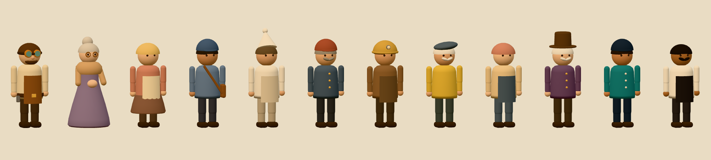

## L'eau qui bouge (version 1.1)

- Des **reflets clairs** ondulent lentement à la surface du puits, de la
  fontaine et du canal ; dans le canal, ils glissent dans le sens du courant.
- Des **ronds dans l'eau** s'élargissent puis s'effacent (dans le puits et
  dans les deux vasques de la fontaine, où l'eau bouillonne doucement).
- Quelques **feuilles flottent** au fil du canal du moulin.

Tout est lent et peu contrasté : rien ne clignote. Si votre système demande
« moins d'animations », l'eau reste immobile.

## La gare à vapeur (version 1.2)

On y arrive par la route à l'est du moulin, une fois la roue réparée.
**Augustin**, le chef de gare, a deux problèmes : sa grande horloge s'est
arrêtée (à quatre heures dix), et le sifflet de sa locomotive a rouillé.
Sans l'heure et sans sifflet, aucun train ne peut partir !

Une fois l'horloge réparée, elle **donne l'heure du jeu** (on peut la lire en
s'approchant). Une fois le train réparé, il fait un tour toutes les
100 secondes : il attend à quai en fumant, démarre lentement vers l'est (avec
un petit « tchou » si les sons sont activés), disparaît, puis revient de
l'ouest en ralentissant. Ses roues tournent, sa fumée traîne derrière lui.

## Le jour et la nuit (version 1.2)

Une journée entière de Cuivrebourg dure **8 minutes**. Une nouvelle partie
commence le matin, vers 8 heures, et l'heure est sauvegardée avec la partie.

- Le soir, le ciel prend des couleurs chaudes, puis bleues ; un petit message
  prévient : « Le soir tombe sur Cuivrebourg ».
- La nuit, **les fenêtres et les lanternes s'allument**, avec un halo doré.
  Il y a des lanternes dans chaque lieu.
- Au matin, le jour se lève doucement.

Pour le confort : tout change très lentement (le test automatique vérifie
qu'aucune image ne change de plus de 0,2 % par rapport à la précédente), la
nuit reste claire, et **les ombres ne bougent pas**. Dans les options, on peut
choisir « Toujours le jour ».

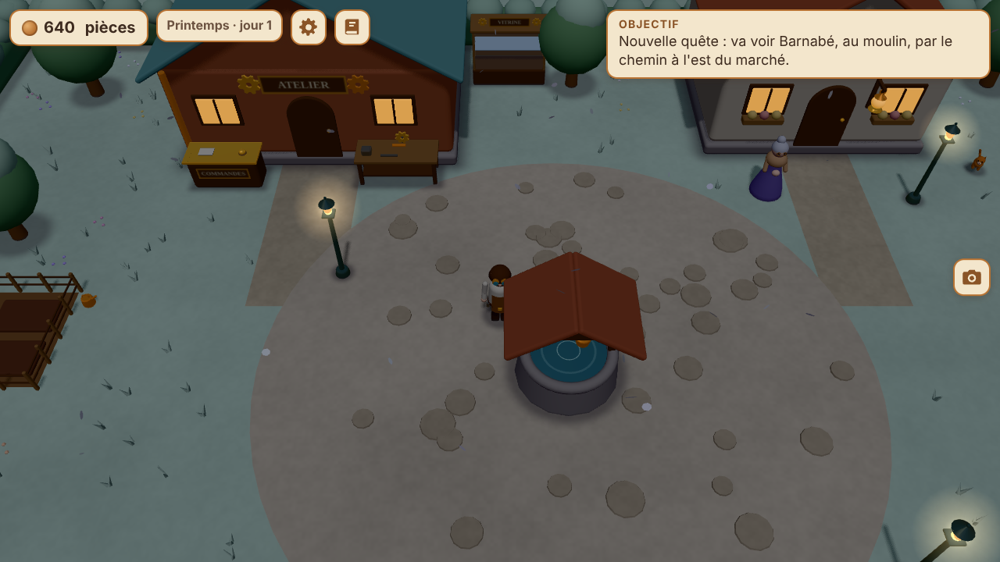

## Un décor qui vit (version 1.2)

- De la **fumée** sort doucement des cheminées : la forge de l'atelier (plus
  épaisse pendant une fabrication), la maison d'Odile, la boutique d'épices,
  le moulin, la gare et la locomotive. Les bouffées montent, grossissent,
  penchent avec le vent et s'effacent.
- Le **vent** fait bouger un tout petit peu le feuillage des arbres et des
  buissons, chacun à son rythme.

## Le voyage en train et la mine (version 1.3)

Une fois le premier train réparé, approchez-vous de la locomotive quand elle
est **à quai** et appuyez sur `E` : « Monter dans le train ». Un petit « tchou »,
un fondu, et Ferrus descend sur le quai de la mine de cuivre. Pour rentrer,
approchez-vous du train de la mine : « Rentrer à Cuivrebourg en train ». Si le
train de la gare est parti, l'aide indique « Le train revient bientôt » : il
suffit d'attendre un peu.

## Les nuits de Cuivrebourg (version 1.3)

- Des **lucioles** flottent lentement au bord du canal du moulin, près des
  arbres du sud de la place, et à la mine. Elles ne clignotent pas : leur
  lueur grossit et diminue très doucement.
- Les **étoiles se reflètent dans l'eau** du puits, de la fontaine et du canal,
  et ondulent avec les vagues. Pourquoi dans l'eau ? Parce que la caméra
  regarde le village d'en haut, vers le sol : on ne voit jamais le ciel
  lui-même. Mais l'eau, elle, le reflète.
- Le petit casque de Sidonie et les yeux de l'automate s'allument la nuit.

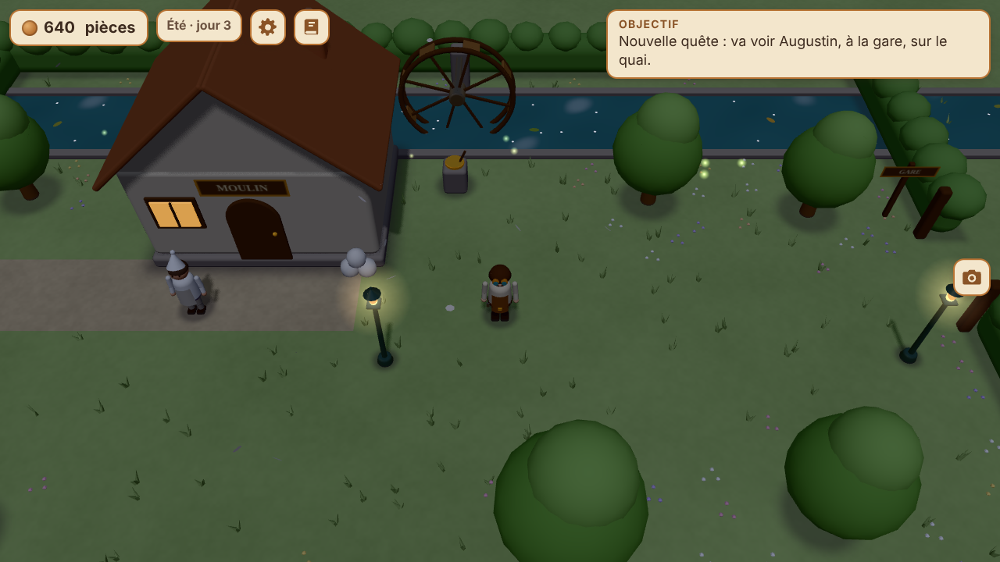

## La galerie de la mine (version 1.4)

Une fois le wagonnet de Sidonie réparé, approchez-vous de l'entrée de la mine
(dans les rochers, à droite) et appuyez sur `E` : « Descendre dans la mine ».
Sous terre, la lumière ne suit pas le jour et la nuit : ce sont les lanternes
qui éclairent, toujours de la même lumière chaude.

Quatre **filons de cuivre** brillent dans la roche (trois au fond, un à
droite). Devant un filon, `E` : « Détacher du cuivre ». Chaque filon donne
**1 plaque de cuivre**, rangée directement dans le stock de l'atelier
(gratuitement !). Le filon est ensuite vide : ses cristaux deviennent tout
petits, puis regrandissent. Il est de nouveau prêt au bout de **90 secondes**.
Pour ressortir, marchez vers le tunnel « SORTIE », à gauche.

## Les saisons (version 1.4)

Une nouvelle partie commence au printemps. Chaque saison dure **2 jours** du
jeu (environ 16 minutes), et le passage d'une saison à l'autre prend environ
4 minutes : tout change très lentement. Le petit calendrier, à côté de
l'argent, indique la saison et le jour (« Printemps · jour 3 »).

| Saison | Ce qui change |
|---|---|
| Printemps | Une herbe plus tendre, des **petites fleurs** le long des haies et autour des arbres, et quelques **pétales** qui volent |
| Été | Les couleurs d'avant (rien ne tombe du ciel) |
| Automne | Des arbres **roux et dorés**, et des **feuilles mortes** qui tombent en tournoyant |
| Hiver | De la **neige** sur l'herbe, les haies et le haut des arbres, et quelques **flocons** qui tombent lentement |

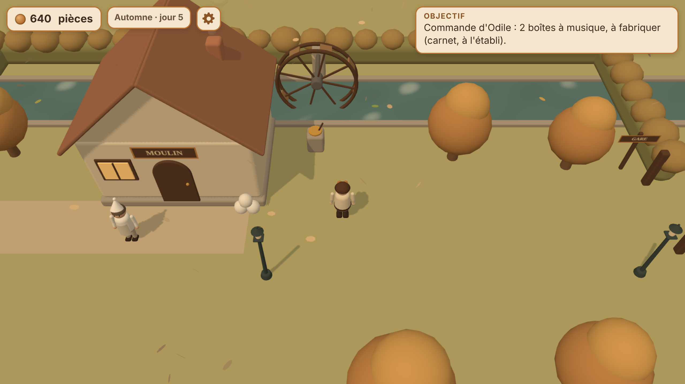

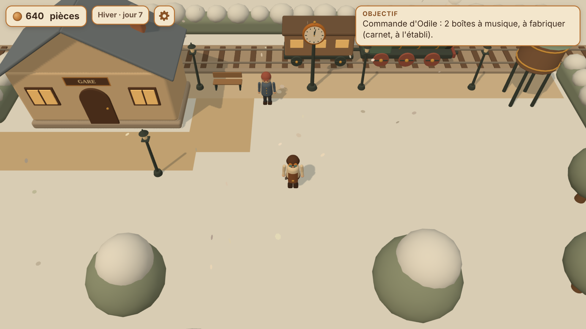

Dans la galerie, sous terre, il n'y a ni fleurs ni neige. Si le système
demande « moins d'animations », rien ne tombe du ciel (les couleurs changent
quand même).

## Le carnet de commandes (version 1.4)

Après votre premier client servi au comptoir, **Léon le facteur** apporte
parfois une **commande spéciale** le matin : un habitant que vous avez aidé
(Odile, Capucine, Barnabé, Augustin ou Sidonie) voudrait plusieurs objets
d'un coup, par exemple « 3 lanternes ».

- Au plus **une nouvelle commande par jour**, et **deux** en même temps.
- On a **2 jours de plus** pour la livrer (« avant la fin du jour 5 »).
- Quand les objets sont prêts, ouvrez l'onglet **Carnet** à l'établi et
  appuyez sur **Livrer** : Léon s'en charge. Une commande rapporte **1,5 fois**
  le prix du comptoir.
- Pas de stress : une commande qui n'est pas prête à temps est simplement
  annulée, gentiment, **sans aucune pénalité**. Une autre viendra.

Quand aucun client n'attend, le cadre « Objectif » rappelle la commande en
cours, et un losange ambre flotte au-dessus de l'établi quand elle est prête.

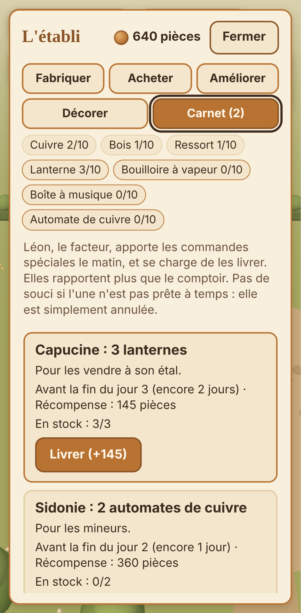

## Les décorations de l'atelier (version 1.4)

Dans l'onglet **Décorer** de l'établi. Elles ne changent rien aux règles :
c'est seulement pour le plaisir des yeux. Chacune apparaît aussitôt sur la
façade de l'atelier.

| Décoration | Prix | Où |
|---|---|---|
| Tapis d'accueil | 25 | Un tapis rayé devant la porte |
| Lanterne de porte | 30 | À gauche de l'entrée ; elle s'allume le soir |
| Guirlande de fanions | 35 | Le long des deux pentes du toit ; les fanions se balancent un peu au vent |
| Plantes en pots | 40 | Deux grands pots fleuris, aux coins de l'atelier |
| Jardinières fleuries | 45 | Sous les deux fenêtres |
| Girouette en cuivre | 55 | Un petit coq sur le toit, qui tourne lentement au gré du vent |
| Horloge murale | 70 | Sur la façade ; elle donne l'heure de Cuivrebourg |

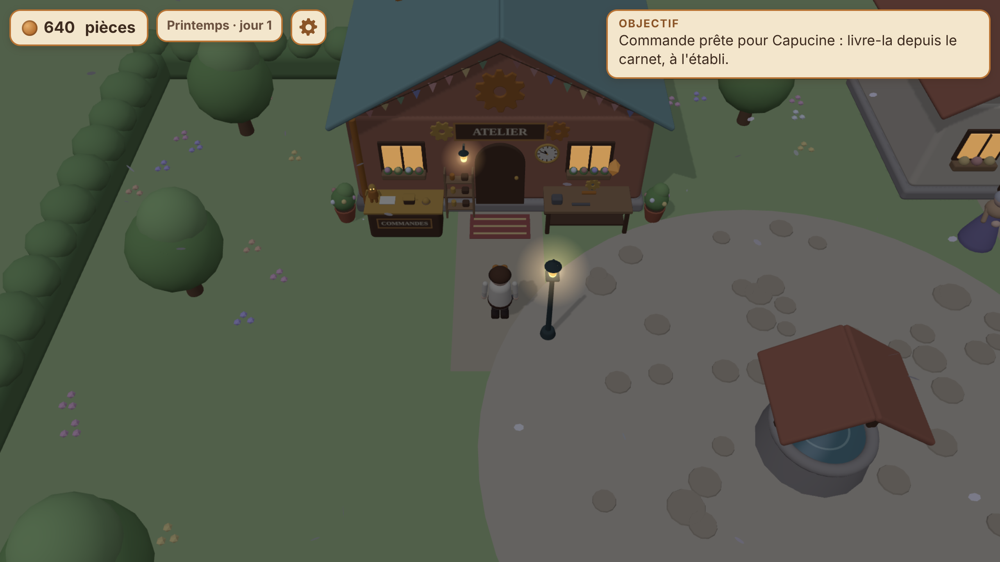

## Confort visuel et sonore

Couleurs douces et chaudes, éclairage doux, aucun clignotement, aucune
secousse de caméra. **Aucun son tant qu'on ne l'a pas activé** dans les
options ; et même activés, musique et sons restent doux. Si votre système
demande « moins d'animations », les engrenages et les marqueurs ne flottent
plus, l'eau, la fumée, le feuillage et les lucioles restent immobiles, rien
ne tombe du ciel (pétales, feuilles, flocons), et le joystick ne glisse plus.

## Vérifier les règles du jeu (tests automatiques)

```bash
npm test
```

(C'est la même chose que `node --test`.) 158 tests vérifient les quêtes,
l'argent, les collisions dans les six lieux (avec des centaines de
promenades au hasard : Ferrus ne se coince jamais), la gestion de l'atelier (dont
une partie de 15 minutes jouée automatiquement), la sauvegarde (y compris
des sauvegardes abîmées ou trafiquées), les options, la musique (toutes les
notes dans la gamme, pas de grand saut, des silences pour respirer), les
formes arrondies (bonne taille, aucune surface à l'envers), le jour et la
nuit et les saisons (aucun changement brusque), l'horaire du train, la
galerie et ses filons, le carnet de commandes, les décorations et les
fichiers d'installation. Tout doit être indiqué `pass`.

## L'organisation des fichiers

| Fichier ou dossier | Rôle |
|---|---|
| `index.html` | La page du jeu : écran d'accueil, interface, message d'erreur |
| `css/style.css` | L'apparence : couleurs, tailles de texte, boutons tactiles |
| `js/logique.js` | **Les règles du jeu**, sans aucune 3D : plan de la place, collisions (clients compris), objectif, marqueurs, dialogue d'Odile |
| `js/logique-atelier.js` | **Les règles de l'atelier**, sans aucune 3D : matériaux, recettes, clients, améliorations, prix |
| `js/logique-quetes.js` | **Le moteur de quêtes**, sans aucune 3D : toutes les quêtes (la lampe d'Odile, la balance, la roue) décrites comme des données, leurs étapes et leurs textes |
| `js/logique-zones.js` | **Les lieux**, sans aucune 3D : plan du marché et du moulin, sorties, portes fermées ou ouvertes, répliques de Léon |
| `js/logique-sauvegarde.js` | Transforme la partie en texte et la relit en vérifiant tout |
| `js/logique-temps.js` | **Le jour et la nuit**, sans aucune 3D : l'heure, le numéro du jour, les couleurs de chaque moment, l'horaire du train |
| `js/logique-saisons.js` | **Les saisons**, sans aucune 3D : les couleurs de chaque saison, ce qui tombe du ciel, le calendrier |
| `js/logique-commandes.js` | **Le carnet de commandes**, sans aucune 3D : qui commande quoi, pour quand, et combien ça rapporte |
| `js/logique-galerie.js` | **La galerie de la mine**, sans aucune 3D : les filons de cuivre et leur temps pour se reformer |
| `js/logique-reglages.js` | **Les options**, sans navigateur : valeurs de départ, volumes, qualité, numéro de version |
| `js/logique-musique.js` | **La composition de la musique**, sans son : gammes, accords, mélodie, petits sons |
| `js/musique.js` | Fait sonner la musique et les petits sons (Web Audio, le synthétiseur du navigateur) |
| `js/interface-options.js` | Le panneau des options (musique, sons, qualité, plein écran, installer) |
| `js/main.js` | Le chef d'orchestre : crée la scène 3D, la caméra, la lumière, et fait tourner le jeu |
| `js/decor.js` | La place en 3D : sol, haies, arbres, puits, atelier, maison d'Odile, établi, lampe, comptoir, améliorations, décorations |
| `js/decor-zones.js` | Le marché et le moulin en 3D : étals, fontaine, canal, roue à aubes, pales, barrière de la gare |
| `js/decor-gare.js` | La gare en 3D : voie ferrée, quai, horloge, locomotive et wagon, château d'eau |
| `js/decor-mine.js` | La mine de cuivre en 3D : quai en bois, cabane, entrée dans les rochers, wagonnet, pépites |
| `js/decor-galerie.js` | La galerie souterraine en 3D : parois de roche, étais, lanternes, source, chariot, filons de cuivre |
| `js/saisons.js` | Les saisons en 3D : couleurs de l'herbe et des arbres, fleurs du printemps, pétales, feuilles mortes et flocons |
| `js/vie.js` | Le décor qui vit : fumée des cheminées, vent dans les feuillages, lanternes et fenêtres qui s'allument la nuit, lucioles |
| `js/formes.js` | Les formes de base aux bords arrondis : boîtes, cylindres, gélules, formes « tournées » comme un vase |
| `js/eau.js` | L'eau qui bouge : reflets qui ondulent, ronds dans l'eau, feuilles au fil du canal, reflet des étoiles la nuit |
| `js/personnages.js` | Ferrus (avec ses lunettes d'artisan), Odile, Capucine, Barnabé, Léon, Augustin, Sidonie, les clients, et leurs animations |
| `js/commandes.js` | Le clavier, le joystick tactile (qui vient sous le pouce) et le bouton « Interagir » |
| `js/interface.js` | L'argent, le calendrier, l'objectif, la barre de fabrication, les petits messages, la boîte de dialogue |
| `js/interface-atelier.js` | Le panneau de l'établi (onglets Fabriquer, Acheter, Améliorer, Décorer, Carnet) |
| `lib/three/` | Three.js 0.186.1 (le moteur 3D), copié ici pour ne dépendre d'aucun site extérieur |
| `tests/logique.test.js` | Les tests automatiques des règles de l'étape 1 |
| `tests/atelier.test.js` | Les tests automatiques de la gestion de l'atelier |
| `tests/etape3.test.js` | Les tests automatiques des quêtes, des lieux et de la sauvegarde |
| `tests/etape4.test.js` | Les tests automatiques des options, de la musique et des fichiers d'installation |
| `tests/formes.test.js` | Les tests automatiques des formes arrondies |
| `tests/version12.test.js` | Les tests automatiques de la gare, du jour et de la nuit, et du train |
| `tests/version13.test.js` | Les tests automatiques du voyage en train, de la mine, de la boîte à musique et de l'automate |
| `tests/version14.test.js` | Les tests automatiques de la galerie, des saisons, du carnet de commandes et des décorations |
| `manifest.webmanifest` | La « fiche d'identité » de l'application : nom, icône, couleurs, plein écran |
| `sw.js` | Le « service worker » : garde une copie du jeu pour jouer sans connexion |
| `icones/` | L'icône du jeu (un engrenage de cuivre et une flamme) : le dessin `icone.svg` et ses versions PNG |
| `serveur.js` | Le petit serveur lancé par `npm start` |
| `outils/copier-three.js` | Recopie Three.js de `node_modules` vers `lib/three/` (`npm run copier-three`) |
| `outils/creer-zip.js` | Fabrique l'archive de sauvegarde (`npm run zip`) |
| `atelier-cuivrebourg.zip` | Une sauvegarde de tout le projet (sans `node_modules`) |
| `captures/` | Des captures d'écran du jeu (ordinateur et téléphone) |
| `package.json` | La fiche du projet : nom, commandes, version de Three.js |
| `LICENSE` | La licence du code (Creative Commons BY-NC-ND 4.0) |

Le dossier `node_modules` (créé par `npm install`) n'est pas envoyé sur
GitHub : le fichier `.gitignore` l'en empêche.

## L'archive de sauvegarde

`atelier-cuivrebourg.zip` contient tout le projet, sauf `node_modules`. On
peut la télécharger depuis le téléphone à cette adresse :
https://ferrusdantioch.github.io/atelier-jeu/atelier-cuivrebourg.zip

Pour la refaire après une modification :

```bash
npm run zip
```

## Publication (GitHub Pages)

Le jeu est publié par GitHub Pages, depuis la branche `main`, dossier racine.
À faire une seule fois, sur le site de GitHub :

1. Ouvrir le dépôt `atelier-jeu`, puis **Settings** (Paramètres).
2. Dans le menu de gauche, **Pages**.
3. Dans « Build and deployment », choisir **Deploy from a branch**, puis la
   branche **main** et le dossier **/ (root)**, et cliquer **Save**.

Ensuite, chaque modification envoyée sur `main` est en ligne 1 à 2 minutes
plus tard (parfois un peu plus : GitHub met la publication en file d'attente).

**Partager le jeu** : il suffit d'envoyer l'adresse
https://ferrusdantioch.github.io/atelier-jeu/ . Dans les messageries, le
lien s'affiche avec le titre du jeu et une image du marché.

**Publier une nouvelle version** : changez le numéro de version (par exemple
`1.4.0` → `1.4.1`) aux **trois** endroits suivants, puis envoyez sur `main` :
`package.json`, `js/logique-reglages.js` (`VERSION_JEU`) et `sw.js`
(`VERSION`). Un test vérifie qu'ils sont identiques. Les téléphones qui ont
installé le jeu reçoivent la nouvelle version à la prochaine ouverture avec
une connexion.

## Mettre à jour Three.js (pour plus tard)

Changez la version dans `package.json`, puis lancez `npm install` : les
fichiers de `lib/three/` sont recopiés automatiquement. Vérifiez ensuite que
le jeu fonctionne toujours.

## La suite prévue

- ~~**Étape 2** : la gestion de l'atelier (fabrication, stocks, clients, améliorations).~~ Fait.
- ~~**Étape 3** : plus de lieux, plus d'habitants, des quêtes enchaînées, la sauvegarde de la partie.~~ Fait.
- ~~**Étape 4** : la musique, les finitions pour téléphone, la publication.~~ Fait (version 1.0).

## Les clients sur la place

Les clients sont « solides » : Ferrus ne passe plus à travers eux, il les
contourne. Et ce sont eux qui font attention : si Ferrus se trouve sur leur
chemin, ils s'arrêtent poliment à quelques centimètres, et repartent dès
qu'il s'écarte. Ils ne le bousculent jamais (pas de secousse).

## Un seul système de quêtes

Toutes les quêtes, y compris la première (la lampe d'Odile), sont décrites
de la même façon dans `js/logique-quetes.js` : qui la donne, ses étapes
(ramasser, fabriquer, livrer, utiliser, parler), ses textes et sa récompense.
Pour ajouter une quête, il suffit d'y ajouter une entrée.

Les parties sauvegardées avant ce changement se reprennent normalement :
le jeu convertit l'ancienne sauvegarde la première fois qu'il la relit.

## Droits

**Code : © 2026 Ferrus Dantioch — Creative Commons BY-NC-ND 4.0**
([résumé de la licence en français](https://creativecommons.org/licenses/by-nc-nd/4.0/deed.fr)),
la même licence que pour l'Omni-système. En clair : le partage est autorisé,
à l'identique et en citant l'auteur ; l'usage commercial est interdit ; la
modification et les œuvres dérivées sont interdites. Le logiciel est fourni
« en l'état », sans aucune garantie. Texte complet dans le fichier
[LICENSE](LICENSE) : le texte officiel en anglais, suivi de la traduction
française officielle publiée par Creative Commons.

**Three.js** (le dossier `lib/three/`) n'est pas concerné : c'est un logiciel
libre d'un autre auteur, sous licence MIT (voir `lib/three/LICENSE`).
