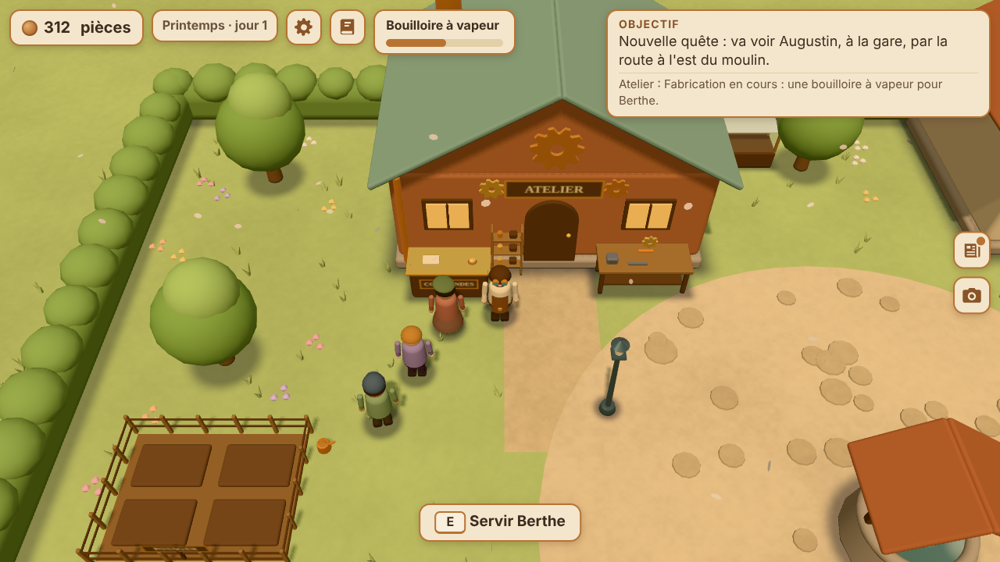
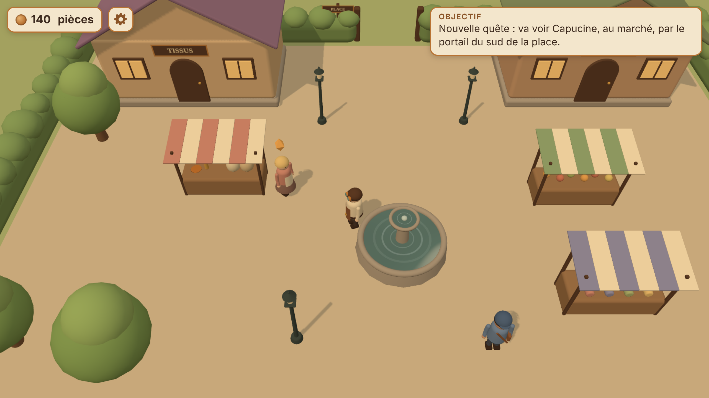
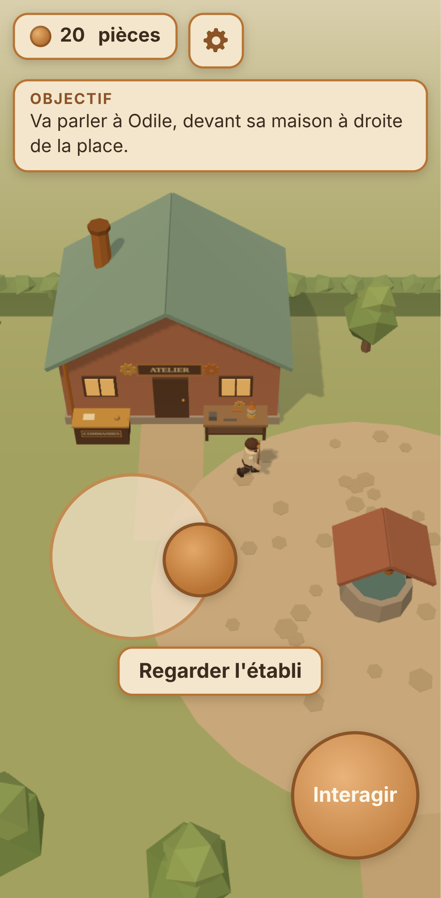
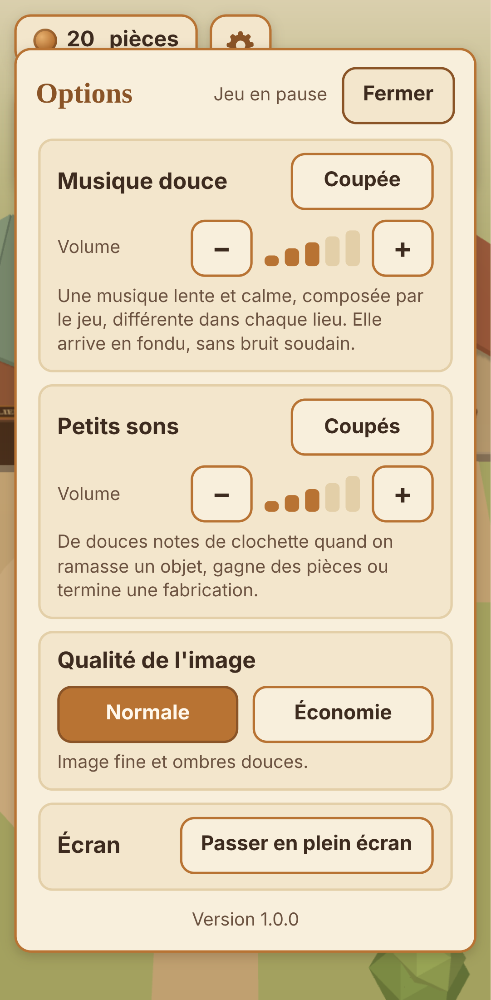
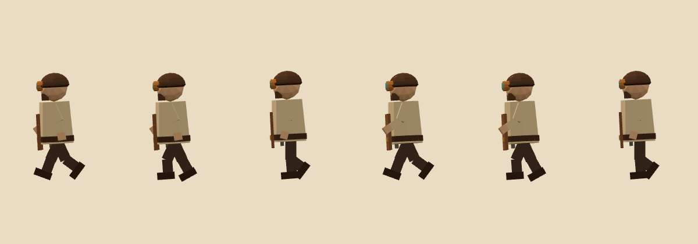

# L'Atelier de Cuivrebourg

Un petit jeu de gestion d'atelier en 3D, ambiance steampunk et artisanat,
qui se joue dans le navigateur, sur ordinateur comme sur téléphone Android.

Vous jouez **Ferrus Dantioch**, artisan-ingénieur. Il reprend un petit atelier
dans une ville en difficulté. Il fabrique et répare des objets pour les
habitants : chaque habitant a un problème à résoudre, ce sont les quêtes.

**Où en est le jeu ?**

- **Étape 1** : une place de village, Ferrus, Odile et une première quête,
  « La lampe d'Odile ».
- **Étape 2** : la gestion de l'atelier. On achète des matériaux, on fabrique
  des objets, on sert des clients et on améliore l'atelier.
- **Étape 3** : deux nouveaux lieux (le marché et le moulin), trois nouveaux
  personnages, des quêtes qui s'enchaînent, et la sauvegarde automatique.
- **Étape 4 (version 1.0)** : une musique douce composée par le jeu (coupée
  au départ), de petits sons, un menu d'options, une démarche plus
  naturelle, un joystick qui vient sous le pouce, et le jeu s'installe sur
  un téléphone comme une application (il marche même sans connexion).





---

## Jouer sur téléphone (ou sans rien installer)

Ouvrez simplement cette adresse dans Chrome :

**https://ferrusdantioch.github.io/atelier-jeu/**

(Elle fonctionne une fois GitHub Pages activé pour ce dépôt, depuis la
branche `main` : voir « Publication » plus bas. GitHub met ensuite 1 à 2
minutes à publier chaque modification.)

### Installer le jeu sur le téléphone (comme une application)

Sur Android, avec Chrome :

1. Ouvrez l'adresse ci-dessus.
2. Touchez **Installer le jeu** (sur l'écran d'accueil du jeu, ou dans les
   options ⚙). Si le bouton n'apparaît pas : menu de Chrome (les trois
   points) → **Installer l'application** (ou « Ajouter à l'écran d'accueil »).
3. Une icône « Cuivrebourg » (un engrenage de cuivre) apparaît sur l'écran
   d'accueil du téléphone.

Lancé depuis cette icône, le jeu s'ouvre **en plein écran**, sans la barre
d'adresse, et il marche **même sans connexion** (dans le métro, en avion…).
Avec une connexion, il se met à jour tout seul. La partie sauvegardée est
la même que dans Chrome.

Sur iPhone (Safari) : bouton Partager → « Sur l'écran d'accueil ».

## Lancer le jeu sur son ordinateur

Il faut avoir installé [Node.js](https://nodejs.org/fr) (version 20 ou plus).
Ensuite, dans un terminal ouvert dans le dossier du jeu (la copie du dépôt `atelier-jeu`),
une seule commande :

```bash
npm start
```

Puis ouvrez **http://localhost:8080** dans votre navigateur.
Pour arrêter : `Ctrl + C` dans le terminal.

Pas besoin de `npm install` pour jouer : Three.js est déjà copié dans le
dossier `lib/three/`.

> Ouvrir `index.html` par double-clic ne marche pas : les navigateurs
> bloquent alors le jeu (le jeu l'explique d'ailleurs à l'écran). Il faut
> passer par `npm start`.

Le terminal affiche aussi une adresse du type `http://192.168.x.x:8080` :
un téléphone connecté **au même Wi-Fi** peut l'ouvrir pour jouer.

## Les commandes

| | Sur ordinateur | Sur téléphone |
|---|---|---|
| Se déplacer | `Z` `Q` `S` `D` ou les flèches (`W` `A` `S` `D` marche aussi) | Joystick en bas à gauche |
| Parler, utiliser | `E` ou `Espace` | Gros bouton **Interagir** en bas à droite |
| Dialogue : réplique suivante | `E` ou `Espace` | Toucher la boîte de dialogue |
| Dialogue : choisir une réponse | Flèches puis `E`, ou clic | Toucher la réponse |
| Panneau de l'établi | Souris (ou `Tab` puis `Entrée`) ; `Échap` ou `E` pour fermer | Toucher les boutons ; **Fermer** en haut |
| Options (musique, sons…) | `Échap`, ou le bouton ⚙ en haut | Bouton ⚙ en haut |

Sur téléphone, le pouce gauche peut se poser **n'importe où dans la moitié
gauche du bas de l'écran** : le joystick vient se placer dessous. Plus besoin
de viser le petit cercle. Au lâcher, il revient à sa place.



## La quête « La lampe d'Odile »

1. Parlez à Odile, devant sa maison (à droite de la place), et acceptez.
2. Trois engrenages apparaissent sur la place : marchez dessus pour les ramasser.
3. Rapportez-les à l'établi, devant l'atelier, pour réparer la lampe à vapeur.
4. Rapportez la lampe à Odile : elle vous donne **120 pièces**.

Le cadre « Objectif », en haut, dit toujours quoi faire. Un petit losange
couleur ambre flotte au-dessus d'Odile ou de l'établi quand il y a quelque
chose à y faire.

## La gestion de l'atelier (étape 2)

Quand Odile a payé, l'atelier ouvre ses portes. Ferrus explique alors en
trois phrases comment tout fonctionne.

- **Le comptoir** (à gauche de la porte de l'atelier) : les clients entrent
  par le portail du sud, font la queue (3 au maximum) et commandent un
  objet. Approchez-vous et appuyez sur `E` (ou **Interagir**) : si l'objet
  est prêt, donnez-le-lui pour être payé.
- **L'établi** (à droite de la porte) ouvre un panneau à trois onglets :
  - **Fabriquer** : choisissez un objet. Il utilise des matériaux et prend
    quelques secondes. Une barre de progression s'affiche en haut de l'écran.
    Un seul objet à la fois.
  - **Acheter** : cuivre (8 pièces), bois (4) et ressorts (6).
  - **Améliorer** : des achats définitifs pour l'atelier.
- **Le stock** : 5 de chaque matériau et de chaque objet au maximum (10 avec
  les étagères).

| Objet | Il faut | Durée | Prix de vente |
|---|---|---|---|
| Lanterne | 1 cuivre, 1 ressort | 6 s | 32 pièces |
| Bouilloire à vapeur | 2 cuivres, 1 bois | 9 s | 45 pièces |
| Horloge mécanique | 1 cuivre, 1 bois, 2 ressorts | 14 s | 75 pièces |

| Amélioration | Prix | Effet |
|---|---|---|
| Étagères | 60 | 10 de chaque au lieu de 5 |
| Soufflet de forge | 90 | Fabrication deux fois plus rapide |
| Enseigne en cuivre | 110 | Un client toutes les 15 s au lieu de 25 s |
| Plans d'horloger | 140 | Débloque les horloges |

Chaque amélioration apparaît dans le décor : étagères près de la porte,
soufflet sur l'établi, grand engrenage au-dessus de l'enseigne, plans roulés.

Le cadre « Objectif » dit toujours quoi faire (acheter, fabriquer, servir),
et un petit losange ambre flotte au-dessus de l'établi ou du comptoir.
Personne n'est pressé : les clients attendent aussi longtemps qu'il faut.
Et si jamais l'atelier se retrouve coincé (ni argent, ni objet à vendre),
Odile prête 30 pièces pour repartir.

## Les lieux et les quêtes (étape 3)

Cuivrebourg compte maintenant trois lieux. On passe de l'un à l'autre en
marchant jusqu'à la sortie, avec un fondu doux.

```
[ La place ]  ── portail du sud ──  [ Le marché ]  ── chemin de l'est ──  [ Le moulin ]
```

- **La place** : l'atelier, Odile, le puits. Le portail du sud s'ouvre quand
  l'atelier ouvre.
- **Le marché** : des étals, une fontaine, **Capucine** la marchande et
  **Léon** le facteur (il connaît toutes les nouvelles et donne des indices).
  Le chemin du moulin est d'abord bloqué par un arbre tombé.
- **Le moulin** : le canal, la grande roue à aubes et **Barnabé** le meunier.

Les quêtes s'enchaînent : chacune ouvre la suivante.

1. **La lampe d'Odile** : ouvre l'atelier et le portail du marché.
2. **La balance de Capucine** : fabriquer une balance de précision à
   l'établi (2 cuivres, 1 ressort), puis la livrer à Capucine. Récompense :
   120 pièces, et le chemin du moulin est dégagé.
3. **La roue du moulin** : retrouver 3 pales dans l'herbe près du moulin,
   fabriquer un axe en laiton à l'établi (1 cuivre, 2 bois), l'installer sur
   le mécanisme au bord du canal, puis revenir voir Barnabé. Récompense :
   150 pièces, et la roue tourne de nouveau.

Les objets de quête n'apparaissent à l'établi que pendant leur quête, et les
clients ne les commandent jamais. L'atelier continue de vivre pendant que
Ferrus est au marché ou au moulin (les fabrications avancent, les clients
attendent). Quand une quête est en cours et qu'un client attend, une
deuxième ligne « Atelier : … » s'affiche sous l'objectif.

## La sauvegarde

La partie se sauvegarde **toute seule** : après chaque action importante,
toutes les 5 secondes, et quand on quitte la page. Au retour, l'écran
d'accueil propose **Continuer la partie** ou **Nouvelle partie** (il faut
toucher deux fois pour confirmer, pour ne pas tout effacer par erreur).

À savoir :

- la sauvegarde reste **dans le navigateur de l'appareil** : la partie du
  téléphone et celle de l'ordinateur sont séparées ;
- effacer les données du site dans le navigateur efface aussi la partie ;
- en navigation privée, le navigateur peut refuser de sauvegarder (le jeu
  marche quand même, sans sauvegarde).

## Les options (étape 4)

Le bouton ⚙ en haut de l'écran (ou `Échap` sur ordinateur, ou « Options »
sur l'écran d'accueil) ouvre les options. **Le jeu est en pause** pendant
qu'elles sont ouvertes (l'atelier attend aussi). Les réglages sont gardés
sur l'appareil, à part de la partie : « Nouvelle partie » ne les efface pas.

| Option | Au départ | Ce qu'elle fait |
|---|---|---|
| Musique douce | **Coupée** | Une musique lente et calme, différente dans chaque lieu (fa majeur sur la place, sol majeur plus enjoué au marché, ré plus rêveur au moulin). Volume en 5 crans. |
| Petits sons | **Coupés** | De douces notes de clochette : objet ramassé, pièces gagnées, fabrication terminée, client qui arrive. Volume en 5 crans. |
| Qualité de l'image | Normale | « Économie » : image moins fine, sans ombres, 30 images par seconde. Pour un téléphone qui chauffe ou se décharge vite. |
| Écran | — | Passer en plein écran (si le navigateur le permet). |
| Application | — | Installer le jeu (quand Chrome le propose). |



**La musique est composée par le jeu lui-même**, note après note, avec un peu
de hasard : il n'y a aucun fichier de musique à télécharger, et elle ne se
répète jamais tout à fait. Elle n'a ni percussions ni notes aiguës perçantes.
Elle arrive en fondu lent (4 secondes) et se tait dès qu'on quitte le jeu
(autre application, écran éteint). Un « limiteur » empêche tout son trop fort.

Les navigateurs n'autorisent le son qu'après un premier geste (toucher,
clic, touche du clavier) : si la musique est activée, elle démarre donc au
premier toucher, par exemple sur « Continuer la partie ».

## La démarche des personnages (étape 4)

Ferrus et les habitants ont maintenant des genoux et des coudes. En marchant,
le genou se plie quand la jambe revient vers l'avant, les bras se balancent
à l'opposé des jambes, le corps monte un peu entre deux pas, et les épaules
tournent légèrement. À l'arrêt, ils respirent doucement.



## Confort visuel et sonore

Couleurs douces et chaudes, éclairage doux, aucun clignotement, aucune
secousse de caméra. **Aucun son tant qu'on ne l'a pas activé** dans les
options ; et même activés, musique et sons restent doux. Si votre système
demande « moins d'animations », les engrenages et les marqueurs ne flottent
plus, et le joystick ne glisse plus.

## Vérifier les règles du jeu (tests automatiques)

```bash
npm test
```

(C'est la même chose que `node --test`.) 90 tests vérifient les quêtes,
l'argent, les collisions dans les trois lieux, la gestion de l'atelier (dont
une partie de 15 minutes jouée automatiquement), la sauvegarde (y compris
des sauvegardes abîmées ou trafiquées), les options, la musique (toutes les
notes dans la gamme, pas de grand saut, des silences pour respirer) et les
fichiers d'installation. Tout doit être indiqué `pass`.

## L'organisation des fichiers

| Fichier ou dossier | Rôle |
|---|---|
| `index.html` | La page du jeu : écran d'accueil, interface, message d'erreur |
| `css/style.css` | L'apparence : couleurs, tailles de texte, boutons tactiles |
| `js/logique.js` | **Les règles du jeu**, sans aucune 3D : plan de la place, collisions, quête, textes |
| `js/logique-atelier.js` | **Les règles de l'atelier**, sans aucune 3D : matériaux, recettes, clients, améliorations, prix |
| `js/logique-quetes.js` | **Le moteur de quêtes**, sans aucune 3D : les quêtes enchaînées décrites comme des données, leurs étapes et leurs textes |
| `js/logique-zones.js` | **Les lieux**, sans aucune 3D : plan du marché et du moulin, sorties, portes fermées ou ouvertes, répliques de Léon |
| `js/logique-sauvegarde.js` | Transforme la partie en texte et la relit en vérifiant tout |
| `js/logique-reglages.js` | **Les options**, sans navigateur : valeurs de départ, volumes, qualité, numéro de version |
| `js/logique-musique.js` | **La composition de la musique**, sans son : gammes, accords, mélodie, petits sons |
| `js/musique.js` | Fait sonner la musique et les petits sons (Web Audio, le synthétiseur du navigateur) |
| `js/interface-options.js` | Le panneau des options (musique, sons, qualité, plein écran, installer) |
| `js/main.js` | Le chef d'orchestre : crée la scène 3D, la caméra, la lumière, et fait tourner le jeu |
| `js/decor.js` | La place en 3D : sol, haies, arbres, puits, atelier, maison d'Odile, établi, lampe, comptoir, améliorations |
| `js/decor-zones.js` | Le marché et le moulin en 3D : étals, fontaine, canal, roue à aubes, pales |
| `js/personnages.js` | Ferrus (avec ses lunettes d'artisan), Odile, Capucine, Barnabé, Léon, les clients, et leurs animations |
| `js/commandes.js` | Le clavier, le joystick tactile (qui vient sous le pouce) et le bouton « Interagir » |
| `js/interface.js` | L'argent, l'objectif, la barre de fabrication, les petits messages, la boîte de dialogue |
| `js/interface-atelier.js` | Le panneau de l'établi (onglets Fabriquer, Acheter, Améliorer) |
| `lib/three/` | Three.js 0.186.1 (le moteur 3D), copié ici pour ne dépendre d'aucun site extérieur |
| `tests/logique.test.js` | Les tests automatiques des règles de l'étape 1 |
| `tests/atelier.test.js` | Les tests automatiques de la gestion de l'atelier |
| `tests/etape3.test.js` | Les tests automatiques des quêtes, des lieux et de la sauvegarde |
| `tests/etape4.test.js` | Les tests automatiques des options, de la musique et des fichiers d'installation |
| `manifest.webmanifest` | La « fiche d'identité » de l'application : nom, icône, couleurs, plein écran |
| `sw.js` | Le « service worker » : garde une copie du jeu pour jouer sans connexion |
| `icones/` | L'icône du jeu (un engrenage de cuivre et une flamme) : le dessin `icone.svg` et ses versions PNG |
| `serveur.js` | Le petit serveur lancé par `npm start` |
| `outils/copier-three.js` | Recopie Three.js de `node_modules` vers `lib/three/` (`npm run copier-three`) |
| `outils/creer-zip.js` | Fabrique l'archive de sauvegarde (`npm run zip`) |
| `atelier-cuivrebourg.zip` | Une sauvegarde de tout le projet (sans `node_modules`) |
| `captures/` | Des captures d'écran du jeu (ordinateur et téléphone) |
| `package.json` | La fiche du projet : nom, commandes, version de Three.js |
| `LICENSE` | La licence du code (Creative Commons BY-NC-ND 4.0) |

Le dossier `node_modules` (créé par `npm install`) n'est pas envoyé sur
GitHub : le fichier `.gitignore` l'en empêche.

## L'archive de sauvegarde

`atelier-cuivrebourg.zip` contient tout le projet, sauf `node_modules`. On
peut la télécharger depuis le téléphone à cette adresse :
https://ferrusdantioch.github.io/atelier-jeu/atelier-cuivrebourg.zip

Pour la refaire après une modification :

```bash
npm run zip
```

## Publication (GitHub Pages)

Le jeu est publié par GitHub Pages, depuis la branche `main`, dossier racine.
À faire une seule fois, sur le site de GitHub :

1. Ouvrir le dépôt `atelier-jeu`, puis **Settings** (Paramètres).
2. Dans le menu de gauche, **Pages**.
3. Dans « Build and deployment », choisir **Deploy from a branch**, puis la
   branche **main** et le dossier **/ (root)**, et cliquer **Save**.

Ensuite, chaque modification envoyée sur `main` est en ligne 1 à 2 minutes
plus tard (parfois un peu plus : GitHub met la publication en file d'attente).

**Partager le jeu** : il suffit d'envoyer l'adresse
https://ferrusdantioch.github.io/atelier-jeu/ . Dans les messageries, le
lien s'affiche avec le titre du jeu et une image du marché.

**Publier une nouvelle version** : changez le numéro de version (par exemple
`1.0.0` → `1.0.1`) aux **trois** endroits suivants, puis envoyez sur `main` :
`package.json`, `js/logique-reglages.js` (`VERSION_JEU`) et `sw.js`
(`VERSION`). Un test vérifie qu'ils sont identiques. Les téléphones qui ont
installé le jeu reçoivent la nouvelle version à la prochaine ouverture avec
une connexion.

## Mettre à jour Three.js (pour plus tard)

Changez la version dans `package.json`, puis lancez `npm install` : les
fichiers de `lib/three/` sont recopiés automatiquement. Vérifiez ensuite que
le jeu fonctionne toujours.

## La suite prévue

- ~~**Étape 2** : la gestion de l'atelier (fabrication, stocks, clients, améliorations).~~ Fait.
- ~~**Étape 3** : plus de lieux, plus d'habitants, des quêtes enchaînées, la sauvegarde de la partie.~~ Fait.
- ~~**Étape 4** : la musique, les finitions pour téléphone, la publication.~~ Fait (version 1.0).

## À améliorer plus tard

- Les clients ne bloquent pas Ferrus : il peut passer à travers eux.
- La quête de la lampe d'Odile utilise encore son code de l'étape 1 ; les
  quêtes suivantes passent par le moteur de quêtes. On pourra l'y faire
  entrer aussi, pour n'avoir qu'un seul système.

## Droits

**Code : © 2026 Ferrus Dantioch — Creative Commons BY-NC-ND 4.0**
([résumé de la licence en français](https://creativecommons.org/licenses/by-nc-nd/4.0/deed.fr)),
la même licence que pour l'Omni-système. En clair : le partage est autorisé,
à l'identique et en citant l'auteur ; l'usage commercial est interdit ; la
modification et les œuvres dérivées sont interdites. Le logiciel est fourni
« en l'état », sans aucune garantie. Texte complet dans le fichier
[LICENSE](LICENSE) : le texte officiel en anglais, suivi de la traduction
française officielle publiée par Creative Commons.

**Three.js** (le dossier `lib/three/`) n'est pas concerné : c'est un logiciel
libre d'un autre auteur, sous licence MIT (voir `lib/three/LICENSE`).
